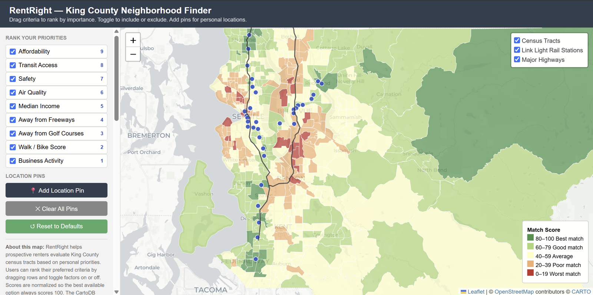

# RentRight: King County Neighborhood Finder

An interactive map that scores King County census tracts against the priorities a renter actually cares about. Rank the criteria by dragging them, switch them on or off, and drop pins on places you need to be near. The map re-scores every tract as you go.

**[Live demo →](https://mfarrell-gis.github.io/rentright-king-county/)**

## The question

Rental sites rank listings by price, beds, and square footage. They don't let you say "I care about transit more than rent, I want to be away from freeways, and I need to be near my job and my partner's." RentRight is a proof of concept for that kind of search: you set the priorities, and the map shows which neighborhoods fit.

## How it works

- **Ranked weighting.** The order of the criteria sets their weights. With nine active criteria, the top one counts 9×, the next 8×, and so on down to 1×.
- **Normalized scores.** Each tract's weighted total is rescaled to 0–100, so the best available tract always scores 100 for your current settings.
- **Personal pins.** Dropping pins adds a "proximity to pins" criterion, scored by each tract's average distance to your pins.
- **Live re-scoring.** Toggling, re-ranking, or moving a pin recolors the map immediately. Clicking a tract shows its overall score and each criterion score.

## Data

Most of the criterion scores are **synthetic**, generated for a course project to demonstrate the method. They are not real neighborhood data.

| Criterion | Source |
|---|---|
| Transit access | **Computed** from distance to real Link light rail station locations |
| Away from freeways | **Computed** from distance to I-5 and I-405 geometry |
| Proximity to pins | **Computed** from distance to user-placed pins |
| Affordability, safety, air quality, median income, golf course buffer, walk/bike score, business activity | **Synthetic**, loosely modeled on ACS, EPA AQI, and local crime and business data |
| Tract boundaries | 2020 Census tracts for King County ([`data/`](data/)) |

The next step for a real version would be to replace the synthetic columns with ACS 5-year estimates, EPA AirNow data, and city crime and business license records.

## Built with

Leaflet · SortableJS · vanilla JavaScript · CARTO Positron basemap · GitHub Pages

## Files

- `index.html`: page layout and sidebar
- `map.js`: map, layers, scoring, pins, and sidebar logic
- `scores.js`: per-tract criterion scores
- `data.js`: tract boundaries, embedded so the page needs no data requests
- `data/king_county_tracts_2020.geojson`: source tract boundaries

## About

Individual project for Geography 465 at the University of Washington, Spring 2026.
